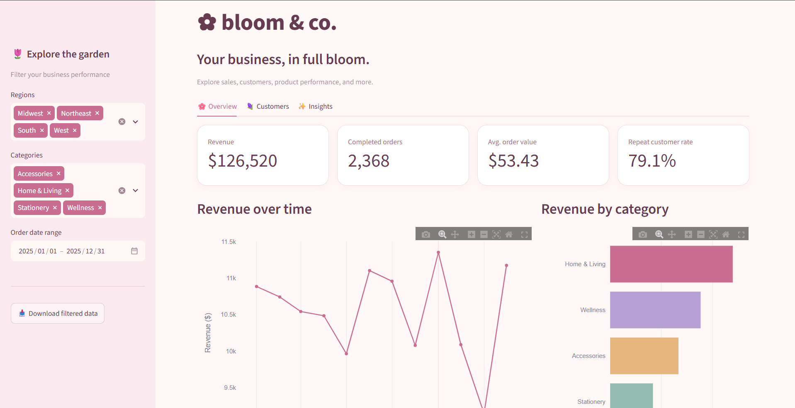
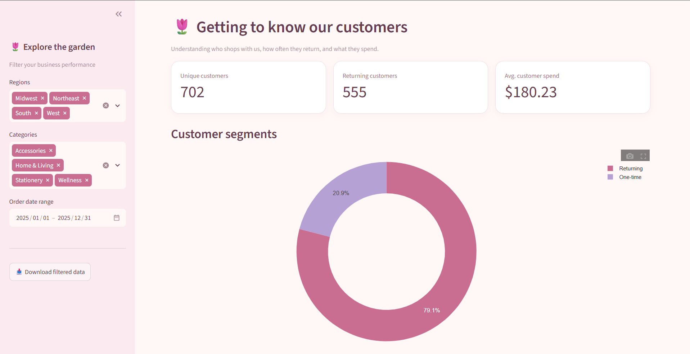
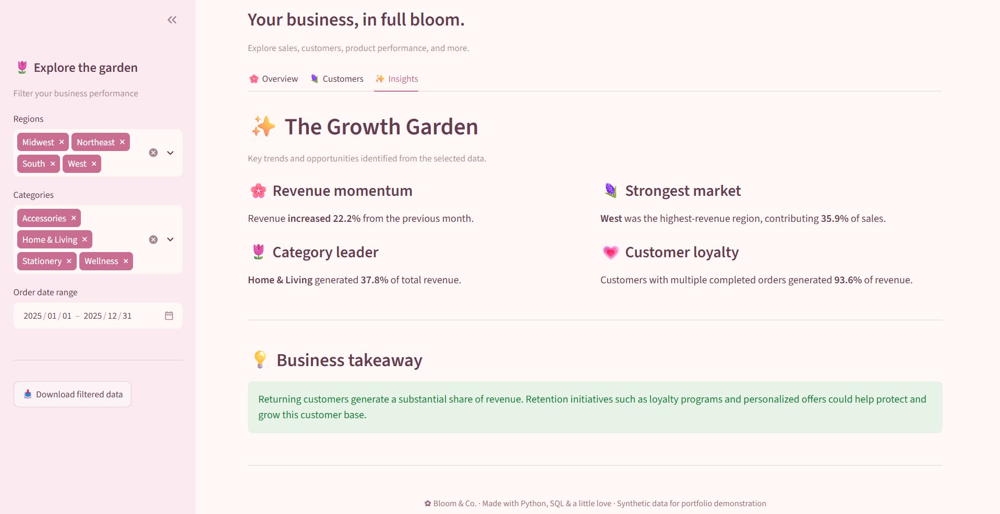

# 🌸 Bloom & Co. | E-Commerce Analytics Dashboard

An interactive business intelligence dashboard built with Python, SQL, Streamlit, and Plotly to explore e-commerce performance, customer behavior, and sales trends.

**Live Demo:** Coming soon

## Project Overview

Bloom & Co. is a fictional lifestyle e-commerce brand. This project simulates a real-world business analytics workflow, from generating and joining relational datasets to calculating KPIs, visualizing performance, and translating data into business insights.

All data is synthetic and generated for demonstration purposes.

## Dashboard Preview







## Key Features

- **Sales Performance:** Revenue, completed orders, average order value, and monthly trends.
- **Customer Analytics:** Customer segmentation, repeat purchase behavior, and spending distributions.
- **Product Performance:** Revenue by category and top-selling products.
- **Regional Analysis:** Geographic revenue comparisons.
- **Dynamic Business Insights:** Automated analysis of revenue growth, category concentration, and returning-customer contributions.
- **Interactive Filters:** Filter by date range, region, and product category.
- **Data Export:** Download filtered transaction data as CSV.

## Technologies

- Python
- Pandas
- SQLite / SQL
- Streamlit
- Plotly
- Git and GitHub

## Data Pipeline

1. Generate reproducible synthetic customer, product, and order datasets.
2. Load CSV files into an in-memory SQLite database.
3. Join relational tables using SQL.
4. Calculate revenue and business performance metrics.
5. Apply interactive filters and generate visualizations.
6. Translate calculated results into actionable business insights.

## Running Locally

```bash
python -m pip install -r requirements.txt
python generate_data.py
python -m streamlit run app.py
```

## Analytical Considerations

- Revenue excludes cancelled and refunded orders.
- Repeat purchase rate measures multiple completed orders within the selected dataset, rather than longitudinal customer retention.
- Month-over-month growth is calculated only when two complete calendar months are available.
- Synthetic data is used to demonstrate analytical techniques, not to make claims about a real business.

## Future Improvements

- Customer cohort and retention analysis
- Revenue forecasting
- Product profitability and margin analysis
- Automated data quality checks

---

*Built as a portfolio project demonstrating business intelligence, SQL, Python, and data visualization skills.*